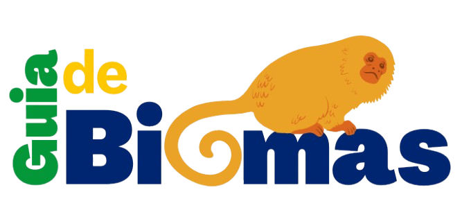
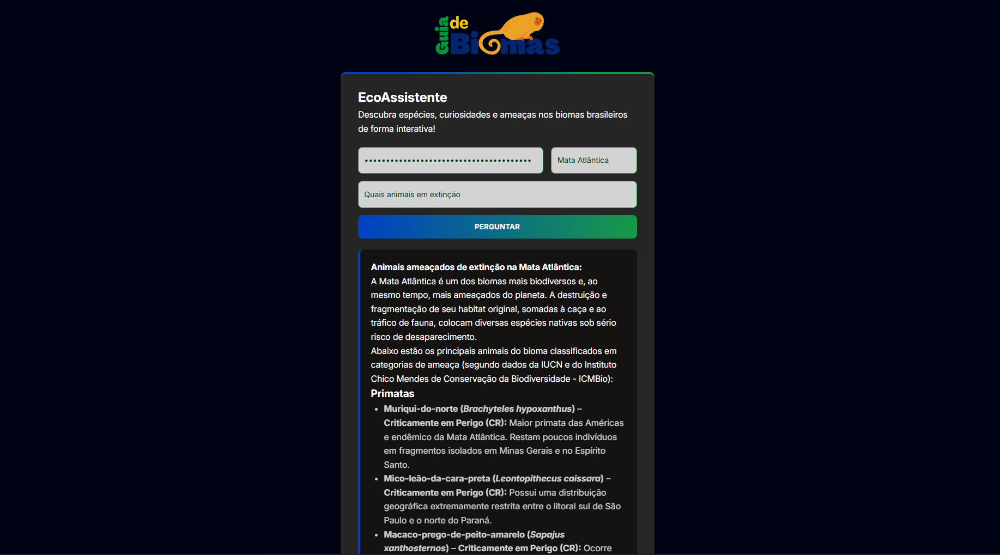
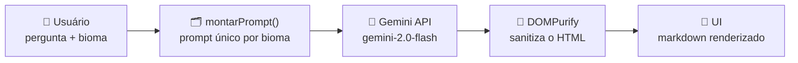

<div align="center">
  

  <h1>🌱 EcoAssistente</h1>

  <p><b>Converse com uma IA especialista sobre os 6 biomas brasileiros 🌿</b></p>

  <p>
    <a href="https://kerollayne-silva.github.io/EcoAssistente/"></a>
    <a href="https://github.com/kerollayne-silva/EcoAssistente/stargazers"></a>
  </p>

  <p>
    
    
    
    
  </p>
</div>

---

## 📸 Preview

<p align="center">
  
</p>

## ✨ O que faz

- 🌎 **6 biomas brasileiros** — Mata Atlântica, Cerrado, Amazônia, Pantanal, Caatinga e Pampa
- 🧬 **Foco em biodiversidade** — características do bioma, espécies, animais ameaçados de extinção e curiosidades
- 💬 **Resposta em markdown** — listas, negrito e tópicos renderizados na hora
- 🛡️ **Erros amigáveis** — chave inválida, cota estourada e sem conexão viram mensagens claras na tela (nunca tela vazia)
- 🔐 **Sua chave, sua sessão** — a API key fica só no navegador e morre ao fechar a aba
- ✨ **Saída sanitizada** — todo HTML passa pelo DOMPurify antes de chegar na tela (proteção contra XSS)

## 🧠 Como funciona



O projeto é **100% frontend — sem backend, sem build e sem `npm install`**: o navegador monta um prompt com as regras do bioma escolhido, chama a API do Gemini e renderiza a resposta sanitizada. O **modo agente** (busca na web + ferramentas externas) está no roadmap abaixo.

## 🛠️ Tecnologias

| Camada | Tecnologia |
|--------|------------|
| Estrutura | HTML5 |
| Estilo | CSS3 (Flexbox + animações) |
| Lógica | JavaScript vanilla — sem framework |
| IA | [Gemini API](https://ai.google.dev/gemini-api/docs) — modelo `gemini-2.0-flash` |
| Markdown → HTML | [Showdown](https://github.com/showdownjs/showdown) |
| Sanitização | [DOMPurify](https://github.com/cure53/DOMPurify) |

As libs chegam via CDN — é só abrir e rodar.

## 🚀 Rodando local

```bash
git clone https://github.com/kerollayne-silva/EcoAssistente.git
cd EcoAssistente
python3 -m http.server 8000
```

1. Abra **http://localhost:8000** no navegador
2. Pegue sua chave gratuita no [Google AI Studio](https://aistudio.google.com/apikey)
3. Cole a chave, escolha um bioma e pergunte!

> [!WARNING]
> **Sobre a API key**: ela fica apenas no seu navegador (`sessionStorage`, válida enquanto a aba estiver aberta) e vai direto da sua máquina para a API do Gemini. Antes de publicar o site, **restrinja a chave por HTTP referrer** nas configurações da chave no Google AI Studio — nenhuma chave em front-end fica 100% escondida; a restrição é a proteção real.

**Não quer clonar?** Use a [demo hospedada no GitHub Pages](https://kerollayne-silva.github.io/EcoAssistente/).

## 🗂️ Estrutura do projeto

```
EcoAssistente/
├── index.html              # interface (form + área de resposta)
├── script.js               # prompts, chamada da API e UI
├── style.css               # visual (tema escuro, verde/azul)
├── assets/
│   ├── logo.png
│   └── preview.png         # screenshot do app em execução
└── study-notes/
    └── web-fundamentals.md # anotações do evento de estudo
```

## 📚 Notas de estudo

Este projeto nasceu num evento de aprendizado. As anotações sobre HTML, CSS, JavaScript e IA estão em [`study-notes/web-fundamentals.md`](./study-notes/web-fundamentals.md).

## 🗺️ Roadmap

- [ ] **Fase 1 — Conversa multi-turno**: histórico de mensagens e chat com bolhas (hoje é pergunta única)
- [ ] **Fase 2 — Modo agente** ⭐: Google Search grounding (respostas com dados atualizados) + function calling consultando bases reais de biodiversidade (GBIF e lista de espécies ameaçadas)
- [ ] **Fase 3 — Qualidade**: testes automatizados, responsividade e melhorias de UX

## ⚠️ Aviso

O EcoAssistente é um **projeto de estudo**, não uma fonte científica. O conteúdo é gerado por IA e pode conter imprecisões — confirme informações sobre conservação de espécies em fontes oficiais como [ICMBio](https://www.gov.br/icmbio/) e [IBAMA](https://www.gov.br/ibama/).

## 🧠 Autor

**Kerollayne Silva** — [@kerollayne-silva](https://github.com/kerollayne-silva)

Feito com 💚 durante uma jornada de aprendizado.